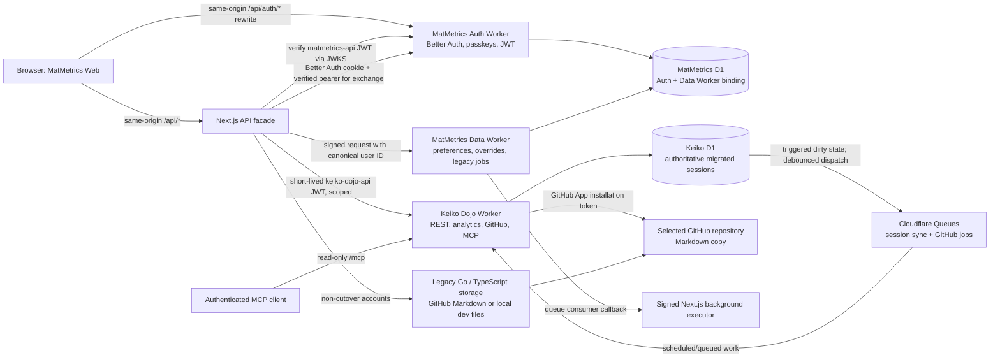

# Current architecture

Assessment date: 2026-11-15. This describes the repository code and the
production checks recorded below; source configuration is not treated as proof
that a component is deployed.

## Summary

MatMetrics is a Next.js application with a same-origin API facade. Its session
backend depends on the account's cutover status: allowlisted identities use
Keiko D1 as the session authority, while other signed-in identities retain the
legacy GitHub Markdown path. Guest mode remains browser-local. The Auth Worker
owns Better Auth identities and passkeys. A separate Data Worker owns user
preferences, plugin overrides, and legacy background jobs; it shares the Auth
Worker's D1 database. Keiko has its own Worker, D1, GitHub App connection, and
Queue pipeline.

For Keiko accounts, session list responses contain a revision per record. The
MatMetrics facade now retains that value as frontend-only `keikoRevision`
metadata and writes use it as `If-Match`. The Keiko API remains authoritative
for tenant checks, validation, and conditional persistence.

## Components and deployment evidence

| Component | Current responsibility and boundary | Evidence and production status |
| --- | --- | --- |
| MatMetrics Web | Next.js UI, same-origin API handlers, auth token verification, session form/history, preferences and plugin clients. Hosted configuration is Vercel-oriented. | `next.config.ts`, `src/app/api/[...path]/route.ts`, `README.md`. Production availability was not queried for this assessment. |
| MatMetrics Auth Worker | Better Auth email/password and passkey endpoints, JWT/JWKS, short-lived Keiko token exchange, auth email dispatch. | `workers/matmetrics-auth/src/auth.ts`, `src/index.ts`, `wrangler.jsonc`. Source config names `matmetrics-auth`; live status was not queried. |
| MatMetrics Data Worker | Signed per-user preference and plugin-override API; persisted `log-doctor-scan` and `github-health` jobs. | `workers/matmetrics-data/src/index.ts`, `wrangler.jsonc`, `migrations/`. Source config names `matmetrics-data`; live status was not queried. |
| Keiko Dojo Worker | Versioned REST API, session domain service, analytics, GitHub App integration and jobs, read-only MCP endpoint. | `keiko-dojo/src/index.ts`, `openapi.yaml`, `wrangler.jsonc`. Cloudflare read-only inspection confirmed production Worker `keiko-dojo`, deployment `5303f76c-8a56-4151-bdd9-b6b0d69c8c03` at 100% traffic, version `a7c66220-8a1d-4326-b7e0-0366b87e68c3`, created 2026-10-25 23:31:59 UTC. |
| Keiko D1 | Authoritative session records for Keiko-routed accounts; revisioned rows and GitHub sync state. | Production D1 `keiko-dojo`, ID `750315f8-ef51-4d6e-86ea-41b076ec9de8`, matches the production `DB` binding in Keiko `wrangler.jsonc`. A read-only query confirmed migrations `0001`–`0007`; `0007_github_session_sync.sql` applied at 2026-10-25 23:30:09 UTC. |
| MatMetrics D1 | Better Auth tables, user preferences, plugin overrides, and legacy background-job records. Auth and Data Worker configs point to the same D1 ID. | `workers/matmetrics-auth/wrangler.jsonc`, `workers/matmetrics-data/wrangler.jsonc`, `workers/matmetrics-data/migrations/`. Live Auth/Data Worker bindings and migration state were not queried. |
| GitHub Markdown | User-selected, portable copy. For Keiko accounts it is asynchronously derived from D1; for legacy accounts it remains the session persistence path. | Keiko `src/http/github-sync.ts`; MatMetrics `src/lib/session-storage.ts`, `src/lib/github-storage.ts`. It is not a transactional database or a D1 restore source. |
| Go API and CLI | Go source contains protected session and GitHub HTTP handlers plus CLI and shared Markdown/session libraries. Next routes can proxy selected-repository operations through `/api/go/*`. | `api/go/`, `internal/`, `go/`; `src/lib/go-function-proxy.ts`. The exact deployed Go handler target was not independently checked. |

Cloudflare also returned Keiko D1 tables for sessions, GitHub connections,
operation jobs, sync state/items, and the sync manifest. The dashboard's D1
database-list `num_tables` field did not agree with the read-only SQLite query,
so table counts are taken from the query, not that summary field. No remote
migration, D1 write, queue trigger, reconciliation, or deployment was run for
this assessment.

## Runtime topology

The browser does not call Keiko with a long-lived credential. For a Keiko
session route, Next verifies the existing `matmetrics-api` JWT, sends the
matching Better Auth cookie and bearer only to the configured Auth Worker, and
receives a five-minute `keiko-dojo-api` token with exact scopes. That token is
sent to Keiko. Keiko validates issuer, audience, subject, `appUserId`, lifetime,
and scope. The Keiko D1 repository filters every read and write by the verified
user ID.

## Responsibility matrix

| Responsibility | Current owner | Target owner | Action |
| --- | --- | --- | --- |
| Authentication, sessions, passkeys, identity IDs | Better Auth Auth Worker and its D1 tables | Auth Worker | Retain; preserve same-origin proxy and exact trusted-origin checks. |
| Training CRUD for cutover users | Keiko REST, `SessionService`, D1 repository | Keiko | Retain as the single authority. |
| Training CRUD for other accounts | MatMetrics TypeScript storage, Go handlers, selected GitHub Markdown | Keiko over time | Keep compatibility until each account is deliberately migrated. |
| Session validation | MatMetrics request validation, Go validation, Keiko domain validation | Keiko authoritative; frontend validates for usability | Avoid cross-phase removal; address duplication only with a contract-driven plan. |
| Training analytics | Keiko D1 analytics for cutover users; MatMetrics derived dashboard calculations and legacy paths | Keiko contract plus frontend presentation | Keep domain aggregation in Keiko when shared; keep chart/view calculations in frontend. |
| Preferences | Data Worker and shared MatMetrics D1, cached in MatMetrics browser state | To be determined | Assess data ownership and auth-D1 coupling before moving or retiring the Worker. |
| Plugin enablement overrides | Data Worker and shared MatMetrics D1; plugin manifests/UI in MatMetrics | MatMetrics product state, backed by a suitable shared data service | Retain current path; decide destination before Data Worker retirement. |
| GitHub session synchronisation | Keiko Queue + GitHub App for cutover users; MatMetrics/Go GitHub Contents API for legacy users | Keiko for migrated training data | Retain asynchronous Keiko path; maintain legacy routing until cutover. |
| Background jobs | Keiko for migrated-account GitHub operations; Data Worker for legacy health/Log Doctor jobs | Domain-specific owner | Keep both while account routes differ; consolidate only after feature and data dependencies are mapped. |
| Offline mutation queue | MatMetrics browser `localStorage` queue with lease and cross-tab merge | Shared frontend logic, upgraded for Companion | Retain Web behavior; use IndexedDB/outbox for a future mobile client. |
| MCP | Keiko `/mcp`, authenticated read-only session tools | Keiko | Retain. REST/OpenAPI stays the frontend contract; UTCP is optional future evaluation. |

## Session workflows

| Workflow | Execution path, checks, storage, and failure behavior |
| --- | --- |
| Sign in | Browser calls same-origin `/api/auth/*`; Next rewrites to the Auth Worker (`next.config.ts`). Better Auth verifies trusted origin, uses its D1 binding, and issues the `matmetrics-api` JWT. Passkey endpoints use the configured exact origin and RP ID (`workers/matmetrics-auth/src/auth.ts`, `wrangler.jsonc`). Auth Worker source applies rate limits and sign-up/enrolment gates in `workers/matmetrics-auth/src/index.ts`. |
| Create | Form calls `saveSession` (`src/lib/storage.ts`); `/api/sessions/create` authenticates and validates. Keiko-routed account: token exchange, then `POST /v1/sessions` to Keiko validation and D1. Legacy account: authorized GitHub config routes to Go `/api/go/sessions/create` when configured, otherwise TypeScript GitHub or local development storage. Keiko insert is revision 1 and enqueues backup state transactionally; queue dispatch is asynchronous. |
| List | `getSessions` reads the scoped browser cache and refreshes `/api/sessions/list`. The authenticated route sends cutover accounts through `listAllKeikoSessions`, aggregating Keiko pages and their `{session, revision}` records; other accounts use authorized GitHub/local storage or Go proxy. The browser normalizes fields and retains the Keiko revision snapshot. Network failures leave cached sessions visible and surface refresh status. |
| Retrieve one | `/api/sessions/[id]` authenticates and checks the account route; Keiko returns the record and strong user-scoped ETag. The MatMetrics facade exposes the numeric revision snapshot separately and passes through only recognized revision ETags. Legacy retrieval reads the authorized Markdown file and its GitHub SHA where applicable. |
| Update | The form retains the originally loaded `keikoRevision`. The route validates the body and forwards the client's `If-Match` without a fresh read. Keiko requires `If-Match`, conditions D1 update on `(user_id, id, revision)`, increments revision, returns 428 when missing, 412 when stale, and 404 when absent. The form leaves input open on errors. Legacy GitHub updates use GitHub blob SHA conflict handling; guest updates stay local. |
| Delete | History retains the list snapshot and sends its Keiko revision. The route forwards `If-Match` directly. Keiko conditionally deletes on the verified user, ID, and revision; stale/missing responses are not converted into an unconditional deletion. Legacy Markdown deletes use the optional `revisionSha`; guest deletes remain local. |
| Offline edit | `updateSession` optimistically updates scoped local cache and queues an `UPDATE` with its original expected revision. The persistent queue is coalesced and uses a cross-tab write lease. Retry sends the same revision. A 412/428/404 is stored as a conflict marker; 401/403 pauses the operation as authentication-blocked. The payload stays in the queue and is excluded from automatic retries. Network/408/429/5xx failures remain retryable. |
| Replay pending mutations | `initializeStorage`/online events call `syncPendingOperations` under a sync lease. Each operation sends through the same Next API path; successful returned revision updates local state. Retryable errors preserve current and later work. Conflict/auth markers remain persisted; unrelated active operations can proceed on a later sync. |
| GitHub Markdown sync | Keiko session-table triggers 0007 update `github_session_sync_state` and per-session items in the same D1 transaction. A 60-second debounce coalesces changes. Queue sends are recovered by a one-minute scheduled handler; a lease/generation guards workers, GitHub failures retry with backoff and terminal failure after configured attempts. Session writes do not wait for GitHub. Legacy accounts still use MatMetrics/Go synchronous Markdown writes. |
| Read preferences | Browser uses `/api/preferences`; Next verifies the user JWT, then signs a short-lived HMAC request binding method, path/query, user ID, body hash, and timestamp to the Data Worker. Worker verifies it and reads the user-scoped preference row. Browser cache provides responsive UI but remote D1 is account persistence. |
| Background GitHub operation | For legacy users, Next validates user and repository then writes a user-scoped Data Worker job; D1 persists before Queue publication, Queue message carries job ID, consumer retries and calls the signed Next executor. For Keiko users, the same product actions route to Keiko job endpoints, which persist tenant-scoped jobs and enqueue Cloudflare Queue work using the GitHub App installation limited to the selected repository. |

## GitHub sync and recovery boundaries

Migration `0007_github_session_sync.sql` adds D1 sync state, per-session dirty
items, a per-repository file manifest, and insert/update/delete triggers. The
trigger records the changed session generation transactionally with the
session mutation. Keiko waits 60 seconds after the latest write before
dispatching ordinary Markdown sync. A one-minute scheduled handler recovers
stale queue wakes and expired leases. Lease tokens and generations guard
against stale workers; changed file paths delete the previous Markdown path,
and deleted sessions remove their old mapped files.

Production source config sets Queue consumers to batches of 10, five retries,
and a dead-letter queue. The session-sync handler also tracks retries and
records `github_sync_failed`; its terminal branch acknowledges the message and
leaves state for scheduled dispatch. Therefore the configured dead-letter
queue is not a guarantee that every terminal sync failure appears there. The
distinct `session_limit_exceeded` branch acknowledges the message and the
scheduled dispatcher explicitly excludes that state. User-visible sync/status
data comes from Keiko's backup status and analytics response.

The GitHub App flow stores one selected repository installation per user and
verifies its repository identity before saving it. This differs from the
legacy path, where selected repository config plus MatMetrics' `GITHUB_TOKEN`
is authorized and forwarded to the Go or TypeScript GitHub implementation.
Keiko uses D1 revision/generation bookkeeping and a selected-repository
Markdown manifest. It does not expose an `Idempotency-Key` for frontend REST
mutations; session IDs and revision checks help but are not a general
request-deduplication contract.

The current full GitHub reconciliation query loads at most 501 session rows
before enforcing `MAX_FULL_SYNC_SESSIONS = 500`. Over the cap, the sync or
sync-all job records `session_limit_exceeded` and the recurring dispatcher
does not retry it. Resolve that limit operationally before assuming a new
connection/full sync can reconcile larger histories. Per-session incremental
updates are separate from this full reconciliation path.

The GitHub copy is not independent backup or restore support. Keiko migration
0007 drops `backup_snapshots`, `backup_jobs`, and `restore_activity`; no
Markdown-to-D1 restore path is implemented. Cloudflare D1 recovery and a
validated, reviewed Markdown import are separate future work.

## Legacy and duplicate implementations

- `src/lib/session-storage.ts` still supports GitHub Markdown and local files.
  `assertLocalStorageAllowed` prevents production Vercel writes to ephemeral
  local storage. Keep these paths for local development and non-cutover users.
- `src/lib/go-function-proxy.ts` can route selected-repository session/GitHub
  handlers through the Go API. Go session validation, serialization, and
  GitHub operations remain in `api/go/`, `internal/`, and `pkg/`.
- Session fields are validated in MatMetrics TypeScript, Go, and Keiko. Keiko
  is authoritative only for Keiko-routed accounts; current compatibility
  routes mean the duplicate code cannot yet be removed safely.
- The browser holds a cache plus optimistic dirty state. This is a UI/offline
  layer, not another authoritative session database. GitHub Markdown is a
  portable secondary copy for Keiko accounts and primary persistence for
  legacy GitHub accounts.
- The Data Worker and Keiko both own job/Queue code because they currently
  serve different account routes and separate domain databases. This is a
  migration seam, not evidence that either Worker is unused.
- The cutover allowlist is `KEIKO_SESSION_CUTOVER_USER_IDS`. The allowlist is
  checked server-side by the same-origin Next routes; it is not client input.

## Contract observations

Keiko's `openapi.yaml` documents session CRUD, keyset pagination, analytics,
ETags, `If-Match`, auth scopes, GitHub operations, and job status. The
implementation in `src/http/sessions.ts`, `src/application/session-service.ts`,
and `src/storage/d1-session-repository.ts` matches the concurrency contract:
list/detail provide numeric revision metadata, detail/mutation responses
provide a user-scoped ETag, updates/deletes require a precondition, and D1
conditions writes on the caller's user ID and revision. The specification also
documents 412, 428, 404, and validation/auth errors. No Keiko contract change
was needed for Phase 1. MatMetrics adds `keikoRevision` only in its facade;
it does not add that frontend field to Keiko's session schema.

The Go/TypeScript legacy routes have their own validation and SHA-based
conflicts. The Web BFF currently aggregates Keiko list pages and returns a
no-store response; it does not expose Keiko pagination cursors to the browser.
Direct Keiko API clients should use OpenAPI pagination and user-scoped caching
rules rather than copying this Web-specific aggregation behavior.
