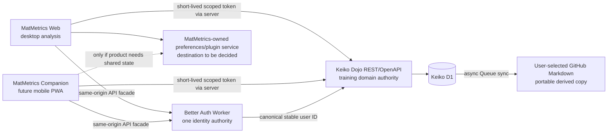

# Target architecture

The target remains a small number of independently deployed products with
clear ownership. It does not require splitting every module into a Worker or
moving non-training data into Keiko.

## Ownership and deployment boundaries

- **MatMetrics Web** owns dashboard presentation, analytics display, goals,
  preferences UI, plugins, and the rich session history experience. Keep
  browser-specific behavior in internal modules.
- **MatMetrics Companion** is a future separate frontend and deployment for
  capture/review. It is not part of Phase 1 and should share API contracts and
  auth behavior rather than copying Web UI code.
- **Keiko Dojo** owns training-session validation and persistence, shared
  analytics, revision semantics, GitHub backup/sync, and its read-only MCP
  integration. `sessions.user_id` remains the verified token subject, never a
  caller-supplied tenant selector.
- **Better Auth Worker** remains a separate deployment and identity authority.
  Keep auth, passkeys, email and JWT issuance out of Keiko.
- **MatMetrics Data Worker** should stay until preferences, plugin overrides,
  and legacy job records have deliberate destinations. It shares a D1 database
  and migration history with Auth, which makes naive retirement unsafe.
- **Repositories**: retain the current MatMetrics and Keiko repositories.
  Companion can start as a separate repository when it is funded for
  independent release. A shared UI framework, shared Worker, or new service is
  not implied by that repository boundary.

## Frontend API and authentication conventions

1. A browser calls only its frontend's same-origin `/api/*` facade. The facade
   validates the Better Auth JWT, CSRF/origin rules, and user-owned repository
   access before calling a service.
2. The frontend server verifies the existing `matmetrics-api` audience and
   exchanges the matching host-only Better Auth session cookie through the
   fixed Auth Worker URL for a short-lived `keiko-dojo-api` token with exact
   scopes. Do not forward the browser JWT or session cookie to Keiko.
3. Keiko verifies the token audience, issuer, subject, `appUserId`, expiry,
   exact requested scope, and user-scoped D1 conditions. A five-minute token
   already issued remains usable until expiry; the next exchange requires a
   valid Better Auth session.
4. Use `/v1/sessions`, `/v1/sessions/{id}`, `/v1/analytics/summary`, and the
   documented `/v1/github/*`, `/v1/backups/*`, and job-status paths from
   Keiko's `openapi.yaml`. Keep the MatMetrics `/api/*` facade stable for its
   browser clients. Avoid a second API style or a frontend-owned database.
5. Keiko list and detail records carry `revision`; detail and mutation
   responses also carry a user-scoped ETag. Send the snapshot ETag (or the
   documented quoted revision compatibility form) as `If-Match` for every
   update/delete. Never fetch a new version immediately before a write. A 412
   requires reload/review; 428 means the client did not retain a revision; 404
   means the resource is absent. These statuses are distinct from retryable
   network/408/429/5xx errors.
6. List consumers use keyset pagination and filters. Use private, user-scoped
   caching only when the client forwards ETags correctly. MatMetrics BFF
   responses remain `no-store`; do not share a cache across identities.
7. Current `POST` create is not idempotent by operation key: duplicate session
   ID returns 409. Before Companion has a durable outbox, add an explicit
   `Idempotency-Key` contract backed by a unique `(user_id, key)` record and
   request-body digest. Keep update/delete protected by revision checks; a
   stable mutation ID should make retries observable and deduplicable.

### Typed SDK strategy

Keep Keiko's checked-in `openapi.yaml` canonical. When the second frontend is
scheduled, pin a Keiko spec release and generate types with
`openapi-typescript`; use a thin `openapi-fetch` transport adapter where it
helps. CI should regenerate from the pinned contract and fail on an uncommitted
diff. Add a small error adapter that preserves HTTP status, Keiko error code,
request ID, and retryability without logging tokens or session contents.

For the first two consumers, generate the same client version into each
frontend from the tagged OpenAPI artifact; keep transport/auth wrappers local
to each same-origin BFF. If the generated surface or behavior is duplicated,
publish a versioned internal TypeScript package built from the Keiko contract.
Do not create a new repository or publish a package during Phase 1.

## Stable domain and passkeys

The current production source configuration uses the exact frontend origin
`https://matmetrics-teal.vercel.app` as Better Auth origin/issuer and as the
WebAuthn RP ID. The Auth Worker trusts one frontend origin in
`workers/matmetrics-auth/src/auth.ts`. Do not add cross-origin cookie access or
wildcard preview origins.

Before launching Companion, choose and establish a durable branded origin.
Prefer routing Web and Companion under one stable site origin (for example,
`https://<stable-domain>/` and `https://<stable-domain>/companion`) while
keeping each app independently buildable/deployable behind path routing. Both
then use the same-origin `/api/auth/*` proxy and host-only cookie. If separate
subdomains are required, each app still needs a same-origin server facade and
an explicit Better Auth trusted-origin design; a parent-domain RP ID may allow
passkeys on subdomains, but it does not make host-only cookies shared.

Passkey credentials are scoped to their RP ID. Moving from the current
`matmetrics-teal.vercel.app` RP ID to a branded domain is not transparent:
existing credentials cannot simply be retargeted. Keep the old sign-in origin
available during an explicit re-enrolment/migration period, test recovery and
account identity continuity, and only retire the old path after credentials
and sessions are accounted for. Do not change `MATMETRICS_AUTH_RP_ID` as an
incidental part of Companion work.

## Companion offline model

For a future mobile PWA, evolve the current `localStorage` mutation queue into
an IndexedDB-backed local database with:

- local drafts and a durable outbox keyed by stable UUID mutation IDs;
- an immutable base revision captured when an edit starts;
- per-user ownership and logout/account-switch isolation;
- exponential retry for network/408/429/5xx, with `Retry-After` support;
- an auth-expired state that retains data and resumes only after sign-in;
- conflict state for 404/412/428 with explicit reload/export/retry choices;
- server-side idempotency keys before automatic replay of creates;
- cross-tab coordination in one browser and conflict detection across devices;
- visible queued, syncing, offline, auth-paused and needs-review status;
- recovery/export of drafts so browser eviction cannot silently erase capture.

Do not automatically retry a conflict using a newer revision: that would
recreate the lost-update defect. Keep the session text and attempted operation
until the user resolves or explicitly discards it.

## Data Worker, recovery, and integration boundaries

Data Worker retirement is a separate decision, not a Phase 1 cleanup task.
Preferences and plugin overrides currently live in its D1 with Auth tables;
legacy `github-health`/`log-doctor-scan` jobs and their Queue records also live
there. Before retirement, inventory consumers, select a destination for each
data type, export/count and verify rows, preserve identity D1 migration
ownership, and define rollback while both readers are compatible. Do not move
all non-session data into Keiko by default.

Keiko's GitHub Markdown sync is an asynchronous portable copy, not an
independent backup. Keiko migration 0007 removed old snapshot/restore tables.
Recovery work must separately define D1 point-in-time recovery, user-requested
recovery of a deleted record, and Markdown-to-D1 import with validation and
dry-run review. Do not present the current Markdown sync as protection against
corrupt or deleted D1 data.

Keep MCP as Keiko's optional authenticated read-only integration. REST/OpenAPI
is the Web and Companion contract. Evaluate UTCP only if a concrete client
needs it; do not add a second integration protocol speculatively.
